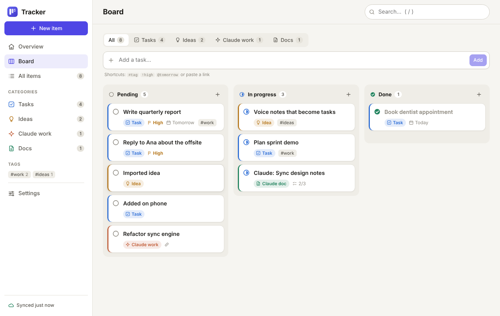
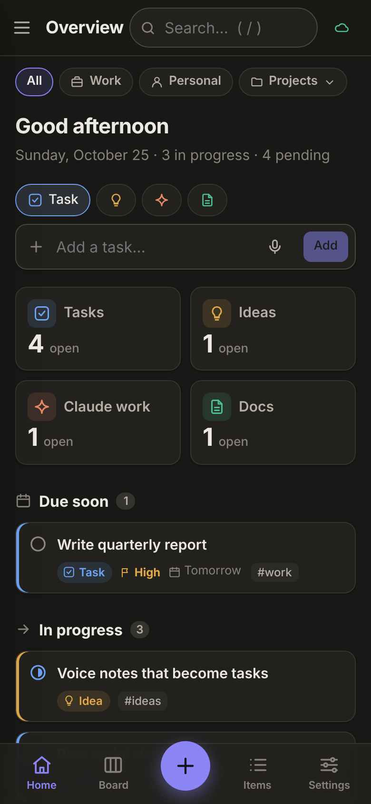

# Tracker

One place for your **tasks**, **ideas**, the **Claude work** you have going, and the **documents you need to read**. Each item moves from **Pending → In progress → Done** (documents: To read → Reading → Read).

It runs as an **Electron desktop app** on your computers and as an **installable web app** on your phone. Everything syncs through a JSON file in a **private GitHub repository**.

 

## Features

- **Four categories**:
  - **Tasks**
  - **Ideas**
  - **Claude work**: Claude Code sessions, PRs, chats, artifacts
  - **Docs**: proposals, artifacts, Claude docs, READMEs, specs, reports, articles
- **Claude connector**: say "send this proposal to my tracker" or "update tasks on my tracker" in any Claude chat or Claude Code session. Proposals and artifacts arrive as files you can read in the app, then approve, request changes or reject with feedback Claude can read back. See [4. Claude connector](#4-claude-connector).
- **Projects and tags**: put each item in a project, mark projects as **Work** or **Personal**, and filter every view by area or by any mix of projects. Tags (for example the repos a proposal touches) show on every card. Manage both on the **Projects & tags** page.
- **Overview**: due soon, in progress, up next, your reading list and recently completed items.
- **Board**: drag cards between columns. On phones you swipe between columns instead.
- **Lists**: filter by category and status, sort by priority, due date and more. Search with plain text or `#tags`.
- **Markdown notes and documents**: paste a doc or import a `.md` file, or drop files onto the window. Checklists (`- [ ] step`) can be ticked right in the reader.
- **Quick add**: `Write report #work !high @tomorrow` sets a tag, the priority and a due date. Pasting a link fills the Link field.
- **Tracker Editor**: the companion [text editor](https://github.com/divaor/tracker-editor) keeps many files open, synced to the same data repo with the same projects and tags. Items sent from it get **Open in editor**, and attached files get **Edit in editor**; your edits come back here. Set its address under **Settings → Tracker Editor**. The desktop app opens these links in the editor's desktop app when it is installed.
- **Notifications**: your phone gets a push notification when Claude sends a document to review, stores a file or changes your tasks, even when the app is closed. The desktop app shows native notifications and can keep running in the system tray.
- **Offline first**: every device keeps a full local copy and syncs automatically when online. Every change is a commit in your data repo, so its history is also your backup.
- **Also**: light and dark theme, keyboard shortcuts, export and import backups.

## How it fits together

```
  Work PC  (Electron) ─┐
  Home PC  (Electron) ─┼──▶  GitHub API  ──▶  private repo  ──  tracker.json
  Phone    (web app)  ─┤                                    └─  files/…  (proposals, artifacts)
  Claude   (connector)─┘
```

The app code (this repo) and your data are kept apart. Each device merges its local copy with `tracker.json` item by item: the most recent edit wins, and deletions sync too. The Claude connector writes to the same repo, through the same merge rules.

---

## 1. Set up sync (once)

1. **Create a private repository** for your data, for example `tracker-data`. It can be empty.
   - You can also keep the data in this repo on its own branch (for example branch `tracker-data`), but only while this repo stays private.
2. **Create a fine-grained personal access token** on GitHub:
   1. Go to Settings → Developer settings → Personal access tokens → **Fine-grained tokens** → Generate new token.
   2. Under *Repository access*, choose **Only select repositories** and pick your data repo.
   3. Under *Permissions → Repository permissions*, set **Contents** to **Read and write**.
   4. When the token expires, sync shows an error. Create a new token and paste it in Settings.
3. In the app, open **Settings → Sync with GitHub**. Enter the owner, the repository and the token, press **Test connection**, then **Save**.
4. On each other device, enter the same settings. Or use **Copy setup code** on one device and paste the code into the other.

## 2. Desktop (work PC, home PC)

**Option A: installers.** Push a version tag:

```sh
git tag v1.0.0
git push origin v1.0.0
```

The **Release desktop app** workflow then builds these files and attaches them to a GitHub release:

- **Windows**: an installer, plus a portable `.exe` that needs no admin rights
- **macOS**: a `.dmg`
- **Linux**: an `AppImage`

The builds are not code-signed, so your system will warn you the first time you open them:

- **Windows**: SmartScreen → *More info* → *Run anyway*.
- **macOS**: right-click the app → *Open*.

**Option B: run from source.** This needs Node.js 20 or newer.

```sh
git clone https://github.com/divaor/tracking_app.git
cd tracking_app
npm install
npm start
```

To build an installer yourself, run `npm run dist:win`, `npm run dist:mac` or `npm run dist:linux`. The output goes to `dist/`.

## 3. Phone

The phone runs the same app as a web app hosted on GitHub Pages.

1. In this repo, go to **Settings → Pages → Build and deployment → Source** and choose **GitHub Actions**. The *Deploy web app to GitHub Pages* workflow publishes the `app/` folder on every push to `main`. You can also run it by hand from the **Actions** tab.
2. On your phone, open `https://divaor.github.io/tracking_app/`. Then install it:
   - **iPhone**: Share → **Add to Home Screen**.
   - **Android**: ⋮ → **Install app**.
3. In the app, open Settings and enter your sync settings.

> **Private repos and Pages:** GitHub Pages for a private repository needs a paid plan (Pro, Team or Enterprise). On the free plan you have two options:
> - Make this repo public. It only holds app code; your data stays in the private data repo.
> - Host the `app/` folder on any static host, such as Cloudflare Pages, Netlify or Vercel.
>
> The site never contains your data. It only talks to `api.github.com` using the token stored on your phone.

## 4. Claude connector

The connector lets Claude work with your tracker from any chat (web, desktop, phone) and from Claude Code. Some things you can say:

- "Send this proposal to my tracker"
- "Send the artifact to my tracker"
- "Update tasks on my tracker: the sync work is done, add a task for docs"
- "Log this session as Claude work on my tracker"
- "Check my tracker for feedback on the proposal and revise it"
- "Save this to my editor as deploy-notes.md", "Find the SQL I pasted about invoices in my editor files"

Documents Claude sends are saved as files in your data repo, under `files/…`, and show up under **Docs**. Open one in the app to read it; HTML artifacts get a safe preview. Then **Approve**, **Request changes** or **Reject** it and leave feedback, which Claude can read back.

Claude can also list, search, read and save your [Tracker Editor](https://github.com/divaor/tracker-editor) files, which live in the same repo under `editor/`. It never reads or changes files you encrypted in the editor.

To set it up:

1. Deploy the small server in [`mcp/`](mcp/README.md) to Cloudflare Workers (free). You can deploy from your computer, or from the **Actions** tab with the *Deploy Claude connector* workflow.
2. In Claude, add `https://<your-worker>/mcp` under **Customize → Connectors → Add custom connector**.
3. Claude opens a sign-in page (OAuth): enter your connector password and press **Allow**.

Full guide: **[mcp/README.md](mcp/README.md)**.

## 5. Notifications

- **Phone (installed web app):** go to **Settings → Notifications**, enter your connector's address and tap **Turn on notifications**.
  - You'll get a push notification when Claude sends a proposal or artifact to review (or a new version), stores a file, or adds, updates, completes or deletes items.
  - Tap a notification to open that item.
  - On iPhone this needs iOS 16.4+, with the app added to the Home Screen and opened from its icon.
- **Desktop app:** native notifications are on by default. It checks for changes every minute, and closing the window keeps it running in the system tray. You can turn that off in Settings.
- **Choose what you hear about:** documents to review, changes Claude makes to tasks and items, and (desktop) changes from your other devices.

---

## Using it

### Projects and tags

- **Filter by project:** the bar above every view filters by **All**, **Work**, **Personal**, or any mix of projects (**Projects ▾**). Your choice is remembered on each device. When you're looking at a single project, new items go into it.
- **Assign a project:** pick or type a project in the item editor (existing names are matched case-insensitively), or type `+project` in quick add.
- **Tag items:** add tags as chips in the editor (with suggestions from tags you already use), or type `#tag` in quick add.
- **Manage them:** the **Projects & tags** page (sidebar → Projects → *Manage*) creates projects and sets their area and color. It also renames or deletes projects (their items move along) and renames or merges tags.
- **From Claude:** say *"for this conversation use project Platform and tag with the repos you touch"*. Claude then files everything it adds or sends under that project and tags each item with the repositories involved, creating projects and tags as needed.

| Quick add syntax                   | Effect                       |
| ---------------------------------- | ---------------------------- |
| `+platform`                        | puts it in the project Platform (loose match) |
| `#work`                            | adds the tag `work`          |
| `!high`, `!low`, `!urgent`         | sets the priority            |
| `!` / `!!`                         | high / urgent priority       |
| `@today`, `@tomorrow`, `@2026-11-02` | sets the due date          |
| `https://…`                        | fills the Link field         |

| Shortcut                   | Action                           |
| -------------------------- | -------------------------------- |
| `N`                        | New item                         |
| `/`                        | Search                           |
| `E`                        | Edit the open item               |
| `Ctrl/⌘ + Enter`           | Save                             |
| `Esc`                      | Close                            |
| `Ctrl/⌘ + Shift + S`       | Sync now (desktop)               |

Some other things you can do:

- Click the round status icon on any card to move the item to the next status.
- Drag **Markdown files** onto the window to add them to your reading list.
- Click a **tag** in the sidebar or on an item to see everything with that tag.
- Search with `#tag` or `+project`. Click a project chip on any item to show that project.

## Data format

`tracker.json` is plain, pretty-printed JSON, so the diffs read well on GitHub:

```json
{
  "app": "tracker",
  "schema": 1,
  "updatedAt": "2026-10-20T09:15:00.000Z",
  "projects": [
    { "key": "platform", "name": "Platform", "area": "work", "color": "#4f46e5", "description": "", "createdAt": "…", "updatedAt": "…", "updatedBy": "Work PC" }
  ],
  "items": [
    {
      "id": "mgx1k2-4f9c0a7b1e2d3c4f",
      "type": "doc",
      "title": "Sync design notes",
      "status": "in_progress",
      "priority": "normal",
      "kind": "claude",
      "project": "tracker",
      "tags": ["work"],
      "url": "https://claude.ai/…",
      "due": "2026-10-24",
      "notes": "# Markdown content…",
      "createdAt": "…",
      "updatedAt": "…",
      "startedAt": "…",
      "completedAt": ""
    }
  ]
}
```

- `type` is one of `task`, `idea`, `claude` or `doc`.
- `status` is one of `pending`, `in_progress` or `done`.
- Deleted items are kept as small `{ "id", "deleted": true, … }` records for 180 days, so the deletion reaches every device.

## Development

```sh
npm install
npm test          # unit tests (node:test): model, merge/sync engine, GitHub client
npm run web       # serve the web app at http://localhost:8080
npm start         # run the desktop app
```

The web app is plain ES modules with no build step:

- **UI**: Preact + htm
- **Markdown**: marked
- **Sanitizing**: DOMPurify

These libraries are copied into `app/vendor/` by `npm run vendor`. GitHub Pages and Electron serve `app/` as-is.

```
mcp/                  Claude connector (MCP server with OAuth and push: Cloudflare Worker, HTTP or stdio)
app/                  the web app (also loaded by Electron)
  js/model.js         item model, merge, quick-add parser, checklists
  js/sync.js          one pull → merge → push round
  js/github.js        GitHub Contents API client
  js/syncManager.js   when to sync (after edits, interval, focus, online)
  js/store.js         local store (IndexedDB)
  js/ui/              views, item editor, settings
  sw.js               offline cache for the web app
electron/             main process + preload (window, app:// protocol, keychain)
scripts/              vendor copy, icon rendering, local web server
test/                 unit tests
.github/workflows/    CI, GitHub Pages deploy, desktop release builds, connector deploy
```

## Security notes

- **Token storage**: the desktop app encrypts the token with your operating system's keychain (Electron `safeStorage`). The web app keeps it in that browser's local storage. Use a fine-grained token limited to the data repo, with Contents read/write only.
- **Markdown**: all Markdown is sanitized with DOMPurify, and the page runs under a strict Content Security Policy.
- **Desktop app**: the Electron window is sandboxed with context isolation, and pages get no access to Node. Outside links open in your default browser.
